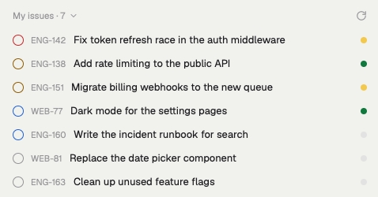
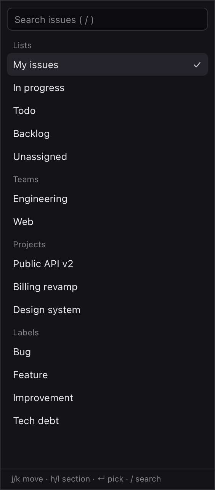

# herdr-linear

A [Herdr](https://herdr.dev) desktop mod that shows your Linear issues in a
panel, next to your terminals and agents. Click an issue's circle to mark it
done, click its title to open it in Linear, click the header to pick which
list to show.



It reads Linear through [`linear`](https://github.com/schpet/linear-cli)
(schpet/linear-cli), so the mod stores no API key: the CLI keeps it in the
system keyring.

## Requirements

- Herdr desktop app
- `linear`, logged in with a [Linear API key](https://linear.app/settings/account/security):

  ```sh
  brew install schpet/tap/linear
  linear auth login
  ```

  `linear auth login` asks for the key. To pass it without typing it, copy it
  and run `pbpaste | linear auth login`. Never put the key on the command line.

  `linear` must be on the PATH of your login shell. If it isn't, the panel says
  so instead of listing issues.

## Install

### With the Herdr app's agent

Ask the agent in Herdr:

> Read ~/.config/herdr-app/AGENTS.md, then add this mod:
> https://github.com/anthonycirc/herdr-linear

It follows [`RECIPE.md`](RECIPE.md).

### By hand

1. Copy the mod into Herdr's home:

   ```sh
   git clone https://github.com/anthonycirc/herdr-linear
   cp -R herdr-linear/mods/linear ~/.config/herdr-app/mods/
   ```

2. Add a block to your layout (`~/.config/herdr-app/layouts/<name>.json`).
   Herdr's own layouts can't be edited: clone one first (`layout.clone`).
   For example, under the agents list in the sidebar's `sidebar-lists` column:

   ```json
   { "id": "linear", "type": "block", "content": { "mod": "linear" }, "size": { "weight": 1 }, "min": 90 }
   ```

3. Check it:

   ```sh
   herdr-app check ~/.config/herdr-app/mods/linear
   ```

## Pick a list

Click the header (`My issues · 20 ⌄`) to choose what the panel shows:

- **Lists**: My issues (Todo and In progress, default), In progress, Todo,
  Backlog, Unassigned
- **Teams**, **Projects**, **Labels**: their Todo and In progress issues
- **Search**: type in the field at the top and press Enter

The choice is kept across restarts. Issues are sorted by state (started first),
then priority, then last update.



The picker works from the keyboard:

| Key                      | What it does                         |
|--------------------------|--------------------------------------|
| `j` / `k`, `↓` / `↑`     | Next / previous item                 |
| `h` / `l`                | Previous / next section              |
| `g` / `G`                | First / last item                    |
| `Enter`                  | Show the selected list               |
| `/` or `i`               | Type a search (`↓`/`↑`, `ctrl-j`/`ctrl-k` still move) |
| `Esc`                    | Leave the search field, then close   |

## What a row shows

- A circle colored by priority (urgent red, high orange, medium blue, low and
  none grey). Clicking it moves the issue to your team's completed state.
- The issue identifier (`ENG-42`) and title.
- A dot in the color of its workflow state; hover it for the state's name.

## Configure

Set `props` on the block. All of them are optional.

| Prop      | Default                         | What it does                                  |
|-----------|---------------------------------|-----------------------------------------------|
| `args`    | `["--assignee", "@me", "--all-teams", "--state", "unstarted", "--state", "started"]` | `linear issue query` filters shown until a list is picked |
| `title`   | `"My issues"`                   | The label of that default list                |
| `refresh` | `60`                            | Seconds between reads (minimum 15)            |
| `key`     | `"default"`                     | Keeps each panel's pick apart when several are shown |

A team's cycle in its own panel:

```json
{ "id": "linear-cycle", "type": "block", "content": { "mod": "linear", "props": { "key": "cycle", "title": "Cycle", "args": ["--team", "ENG", "--cycle", "active"] } } }
```

## Keyboard in the panel

The panel takes the keyboard like a pane: `pane.go` reaches it, for example
`ctrl-h` from the terminal next to the sidebar (`"ctrl-h": "pane.go:left"`).

| Key              | What it does                     |
|------------------|----------------------------------|
| `j` / `k`        | Next / previous issue            |
| `g` / `G`        | First / last issue               |
| `x` or `Space`   | Mark the selected issue done     |
| `Enter` or `o`   | Open it in Linear                |
| `r`              | Refresh                          |
| `/` or `m`       | Pick a list                      |
| `l` or `Esc`     | Back to the pane on the right    |

## Commands and keys

| Command          | What it does              |
|------------------|---------------------------|
| `linear.refresh` | Reads the list again      |
| `linear.menu`    | Opens the list picker     |

This repo's [`keys.json`](keys.json) binds `cmd-shift-i` to `linear.menu`; merge it into
`~/.config/herdr-app/keys.json` (the agent does it when it adds the mod). For
example:

```json
{ "global": { "cmd-shift-i": "linear.menu" } }
```

## What it runs

- `linear issue query <filters> --json --limit all` on each refresh
- `linear team list`, `linear project list`, `linear label list` (`--json`)
  when the list picker opens
- `linear issue update <id> --state completed` when you mark an issue done
- `linear issue view <id> --web` when you open an issue

Everything runs on the local machine. Linear issues belong to your workspace,
not to a machine, so remote Herdr machines show the same list.

## Uninstall

Remove the block from your layout and delete `~/.config/herdr-app/mods/linear`.

## License

MIT
