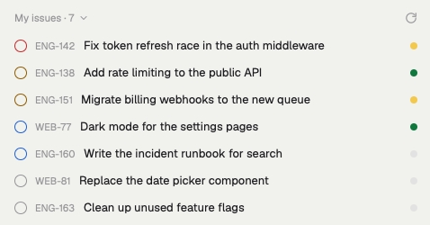
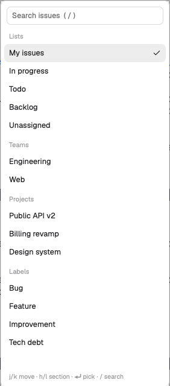

# linear

A panel of your Linear issues, your Todo and In progress ones by default, in
your existing Herdr window. Each row has a priority-colored circle that marks
the issue done, its identifier and a title that opens it in Linear.

## What you see

- A panel with a 41px header: the list's label and issue count
  (`My issues · 20`) with a 12px chevron at 11.5px in `dim`, and a 14px
  refresh icon on the right that spins (900 ms) in `foreground` while the list
  is read.
- 30px rows, 8px rounded, `hover` background: a 14px circle with a 1.5px
  border colored by priority (1 urgent `ansi1`, 2 high `ansi3`, 3 medium
  `ansi4`, 4 low and 0 none `dim`), the identifier at 11px in `dim`, the
  title in `foreground`, truncated, and an 8px dot in the workflow state's
  own color (`state.color`) with the state's name as tooltip.
- `chrome` background with a top `border`, like the sidebar's other lists.
  Empty: "Nothing to do." Without `linear`: "The linear CLI isn't installed
  or isn't on PATH." and the install hint.

## How it behaves

- Reads issues on start, every `refresh` seconds (default 60, minimum 15) and
  when the refresh icon is clicked. Sorted by state type (started, unstarted,
  backlog, triage), then priority (urgent first, none last), then last update.
- Hovering a circle fills it. Clicking it runs `linear issue update <id>
  --state completed`, greys the row while pending, then reads again.
- Clicking a title opens the issue (`linear issue view <id> --web`).
- Clicking the header opens a 280x440 popup: a search input (Enter lists
  `--all-teams --search <text>`), then Lists (My issues, In progress, Todo,
  Backlog, Unassigned), Teams (`linear team list`), Projects (`linear project
  list`) and Labels (`linear label list`, one entry per name), each list being
  a set of `linear issue query` filters; the current one checked. A pick is
  saved with `setShared("linear.view.<key>")`, closes the popup and runs
  `linear.refresh`.

  

- The picker opens with the list focused and the current list selected.
  `j`/`k` and arrows move, `h`/`l` jump between sections, `g`/`G` to the ends,
  Enter picks, `/` or `i` focus the search input (`accent` border), where
  arrows and `ctrl-j`/`ctrl-k` still move and Esc returns to the list; Esc on
  the list closes. A 10.5px `dim` footer lists the keys.
- `mod.json` has `"focusable": true`: `pane.go` gives the panel the keyboard.
  Focused, the selected row has the `selected` background and a footer lists
  the keys: `j`/`k`, `g`/`G`, `x`/Space done, Enter/`o` open, `r` refresh,
  `/`/`m` the picker (as a dialog), `l`/Esc `pane.go` right.
- Commands: `linear.refresh`, `linear.menu` (the picker as a dialog).
- One read at a time: a refresh during a read runs once it ends.
- A failed call shows the CLI's first error line in `ansi1` above the list.
  It keeps the last rows of the same list and clears them for a new one.

## Built from

- `mods/linear/main.js`: one `View`; the popup is the same mod with
  `props.menu`. Imports `View`, `div`, `svg` from `gpui-kit`; `v_flex`,
  `h_flex`, `InputState`, `Input`, `ScrollHandle` from `gpui-base`; `exec`,
  `theme`, `props`, `shared`, `setShared`, `openOverlay`, `closeOverlay`,
  `nextCommand`, `run` from `herdr`. `mod.json`:
  `{ "place": "none", "focusable": true }`. Icons: `refresh.svg`,
  `chevron-down.svg`, `check.svg`.
- Block props: `args` (default filters), `title`, `refresh`, `key`.
- Programs: `linear` (schpet/linear-cli), run locally through
  `exec("linear", …)` with the user's PATH. No network access from the mod
  itself, no key stored: the CLI holds it in the keyring.

## Watch out

- `exec` rejects when `linear` can't start: that is the "not installed"
  state, distinct from a non-zero exit (an error to show).
- `linear issue query` without `--state` includes completed and canceled
  issues, and without `--all-teams` only the configured team's.
- Pass `--limit all`: the default is 50. `--no-pager` keeps it from paging.
- Labels with the same name exist per team: list each name once.
- `--state completed` uses the team's first completed state, skipping review
  states.
- Saving a file reloads the mod in place but the `nextCommand` loop doesn't
  restart: commands reach it again after a fresh start.

## Done when

- `herdr-app check ~/.config/herdr-app/mods/linear` passes.
- The panel lists the same issues as
  `linear issue query --assignee @me --all-teams --state unstarted --state started`.
- Clicking a circle moves that issue to Done and the row disappears.
- Clicking a title opens the issue.
- Picking a team, project or label lists its issues and survives a restart;
  a search lists matching issues.
- `linear.refresh` spins the refresh icon; `linear.menu` opens the picker.
- With `linear` off the PATH, the panel shows the install hint.
